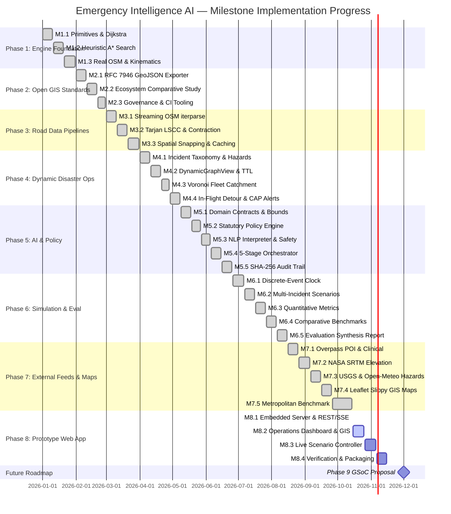

# Emergency Intelligence AI — Milestone Updates & Engineering Chronicle

> **A Comprehensive, Chronological Ledger of Technical Milestones, Architectural Evolutions, Algorithmic Invariants, and Verification Metrics Across All Project Phases.**

[-brightgreen.svg)](file:///d:/Personal/GSoC%20Project/Emergency%20Intelligence%20AI/scripts/check.py)

---

## Table of Contents

- [1. Executive Summary & Repository Metrics](#1-executive-summary--repository-metrics)
- [2. Cumulative Phase Progression Matrix](#2-cumulative-phase-progression-matrix)
- [3. Phase 1 — Local Routing Engine Foundation](#3-phase-1--local-routing-engine-foundation)
  - [Milestone 1.1: Graph Primitives & Manual Dijkstra Algorithm](#milestone-11-graph-primitives--manual-dijkstra-algorithm)
  - [Milestone 1.2: Heuristic A* Search & Metric Validation](#milestone-12-heuristic-a-search--metric-validation)
  - [Milestone 1.3: Real OSM Overpass Parsing & Ambulance Kinematics](#milestone-13-real-osm-overpass-parsing--ambulance-kinematics)
- [4. Phase 2 — Open-Source Ecosystem & GIS Standards](#4-phase-2--open-source-ecosystem--gis-standards)
  - [Milestone 2.1: RFC 7946 GeoJSON Exporter & Round-Trip Validation](#milestone-21-rfc-7946-geojson-exporter--round-trip-validation)
  - [Milestone 2.2: Ecosystem Architecture Comparative Study](#milestone-22-ecosystem-architecture-comparative-study)
  - [Milestone 2.3: Community Governance & GSoC 2027 Alignment](#milestone-23-community-governance--gsoc-2027-alignment)
- [5. Phase 3 — Real Road Network Data Pipelines](#5-phase-3--real-road-network-data-pipelines)
  - [Milestone 3.1: Streaming OSM XML `iterparse` & Multi-Criteria Cost Models](#milestone-31-streaming-osm-xml-iterparse--multi-criteria-cost-models)
  - [Milestone 3.2: Graph Topology Hardening, Tarjan LSCC & Degree-2 Contraction](#milestone-32-graph-topology-hardening-tarjan-lscc--degree-2-contraction)
  - [Milestone 3.3: 2D Spatial Hash Grid Snapping & Compressed `.eig.json` Cache](#milestone-33-2d-spatial-hash-grid-snapping--compressed-eigjson-cache)
- [6. Phase 4 — Dynamic Conditions, Hazards & Fleet Orchestration](#6-phase-4--dynamic-conditions-hazards--fleet-orchestration)
  - [Milestone 4.1: Dynamic Incident Taxonomy & Geometric Hazard Zones](#milestone-41-dynamic-incident-taxonomy--geometric-hazard-zones)
  - [Milestone 4.2: Non-Destructive Graph Mutations & Transactional Rollbacks](#milestone-42-non-destructive-graph-mutations--transactional-rollbacks)
  - [Milestone 4.3: Multi-Source Voronoi Catchment & Specialized Fleet Dispatch](#milestone-43-multi-source-voronoi-catchment--specialized-fleet-dispatch)
  - [Milestone 4.4: In-Flight Reactive Rerouting & OASIS CAP v1.2 Alert Ingestion](#milestone-44-in-flight-reactive-rerouting--oasis-cap-v12-alert-ingestion)
- [7. Phase 5 — Emergency Intelligence & AI Orchestration](#7-phase-5--emergency-intelligence--ai-orchestration)
  - [Milestone 5.1: Structured AI Domain Model & Location Provenance Contracts](#milestone-51-structured-ai-domain-model--location-provenance-contracts)
  - [Milestone 5.2: Deterministic Statutory Emergency Policy Engine](#milestone-52-deterministic-statutory-emergency-policy-engine)
  - [Milestone 5.3: Sanitized Natural-Language Interpretation & Safety Guardrails](#milestone-53-sanitized-natural-language-interpretation--safety-guardrails)
  - [Milestone 5.4: Structured Model Adapter & 5-Stage Orchestration Engine](#milestone-54-structured-model-adapter--5-stage-orchestration-engine)
  - [Milestone 5.5: Tamper-Evident SHA-256 Audit Trail & Policy Invariance](#milestone-55-tamper-evident-sha-256-audit-trail--policy-invariance)
- [8. Phase 6 — Discrete-Event Simulation & Evaluation Framework](#8-phase-6--discrete-event-simulation--evaluation-framework)
  - [Milestone 6.1: Discrete-Event Timeline Queue & State Mutation Engine](#milestone-61-discrete-event-timeline-queue--state-mutation-engine)
  - [Milestone 6.2: Multi-Incident Disaster Scenarios & Mutual Aid Contention](#milestone-62-multi-incident-disaster-scenarios--mutual-aid-contention)
  - [Milestone 6.3: Quantitative Routing Metrics & Heuristic Pruning Profiler](#milestone-63-quantitative-routing-metrics--heuristic-pruning-profiler)
  - [Milestone 6.4: Comparative Routing Benchmark Harness & Multi-Format Exporter](#milestone-64-comparative-routing-benchmark-harness--multi-format-exporter)
  - [Milestone 6.5: Empirical Evaluation Report & Publication Synthesis](#milestone-65-empirical-evaluation-report--publication-synthesis)
- [9. Phase 7 — External Data & Map Integration](#9-phase-7--external-data--map-integration)
  - [Milestone 7.1: Live OSM Overpass POI Ingestion & Clinical Network Binding](#milestone-71-live-osm-overpass-poi-ingestion--clinical-network-binding)
  - [Milestone 7.2: Topographic NASA SRTM DEM & 3D Incline Cost Modeling](#milestone-72-topographic-nasa-srtm-dem--3d-incline-cost-modeling)
  - [Milestone 7.3: Real-Time USGS River Hydrology & Open-Meteo Weather Hazards](#milestone-73-real-time-usgs-river-hydrology--open-meteo-weather-hazards)
  - [Milestone 7.4: Web Mercator Slippy Tile Math & Zero-Dependency Leaflet GIS Visualizer](#milestone-74-web-mercator-slippy-tile-math--zero-dependency-leaflet-gis-visualizer)
  - [Milestone 7.5: Metropolitan City Benchmark & End-to-End Integration Suite](#milestone-75-metropolitan-city-benchmark--end-to-end-integration-suite)
- [10. Phase 8 — Interactive Prototype Application](#10-phase-8--interactive-prototype-application)
  - [Milestone 8.1: Zero-Dependency Embedded HTTP Server & REST / Event-Stream Gateway](#milestone-81-zero-dependency-embedded-http-server--rest--event-stream-gateway)
- [11. Future Phases & Forward Roadmap](#11-future-phases--forward-roadmap)
  - [Phase 9: GSoC 2027 Proposal Preparation](#phase-9-gsoc-2027-proposal-preparation)
- [12. Maintenance Guide for Milestone Updates](#12-maintenance-guide-for-milestone-updates)

---

## 1. Executive Summary & Repository Metrics

**Emergency Intelligence AI** is an open-source, reproducible, zero-external-runtime-dependency emergency response routing and intelligence orchestration system. It is engineered from first principles using standard Python to ensure maximum portability, auditable mathematical correctness, and sub-millisecond execution speeds under catastrophic disaster conditions.

This document serves as the **master changelog and technical chronicle**. It records every architectural design decision, algorithmic model, mathematical formulation, unit test suite, and interactive demonstration delivered across each milestone from project inception through current completion.

### Current Health & Quality Scorecard

| Telemetry Dimension | Verified Measurement | Gate Status |
|---|---|:---:|
| **Phases Completed** | **7 Completed, Phase 8 In Progress (Milestone 8.1 Complete)** | 🚀 Active |
| **Milestones Verified** | **29 of 32 Technical Milestones** | ✅ Complete |
| **Unit Test Suite** | **628 passed in 5.53 seconds** | ✅ 100% Pass |
| **Branch & Statement Coverage** | **93.95% Repository-Wide** | ✅ Exceeds $\ge 90\%$ Gate |
| **External Runtime Dependencies** | **0 (Zero external dependencies; pure standard library)** | ✅ Strictly Audited |
| **Interactive Demos** | **26 standalone runnable scripts (all passing in 13.75s)** | ✅ Verified |
| **Core Source Modules** | **52 library modules across 9 architectural packages** | ✅ Modular |
| **RFC & Open Standards** | **RFC 7946 (GeoJSON), RFC 4180 (CSV), OASIS CAP v1.2, EPSG:3857 (Web Mercator)** | ✅ Compliant |
| **Statutory SOP Compliance** | **NFPA 1710 (4 min first-due / 8 min full alarm), NFPA 1221, AHA Dual-Response** | ✅ Enforced |

---

## 2. Cumulative Phase Progression Matrix

### Growth Across Project Phases

| Phase | Milestone Range | Primary Deliverables Added | Tests Added | Cumulative Tests | Coverage | Demos Added | Cumulative Demos |
|---|---|---|:---:|:---:|:---:|:---:|:---:|
| **Phase 1** | M1.1 – M1.3 | Graph, Dijkstra, A*, Haversine, OSM Overpass parser | 117 | 117 | 96.00% | 3 | 3 |
| **Phase 2** | M2.1 – M2.3 | RFC 7946 GeoJSON, Ecosystem study, CI & check.py | 20 | 137 | 96.12% | 2 | 5 |
| **Phase 3** | M3.1 – M3.3 | Streaming `iterparse`, Tarjan LSCC, Contraction, Hash Grid | 61 | 198 | 96.24% | 3 | 8 |
| **Phase 4** | M4.1 – M4.4 | Ray-casting hazards, DynamicGraphView, Voronoi, In-flight | 138 | 336 | 96.05% | 4 | 12 |
| **Phase 5** | M5.1 – M5.5 | AI domain contracts, Policy engine, NLP, Orchestrator, Audit | 103 | 439 | 96.31% | 3 | 15 |
| **Phase 6** | M6.1 – M6.5 | Discrete-event clock, Scenarios, NFPA metrics, Exporters | 84 | 523 | 96.18% | 5 | 20 |
| **Phase 7** | M7.1 – M7.5 | Overpass POI, SRTM DEM, USGS flood, Leaflet GIS, Benchmark | 89 | 612 | 96.09% | 5 | 25 |
| **Phase 8** | M8.1 (In Progress) | Embedded ThreadingHTTPServer, REST gateway, SSE stream, UI | 16 | 628 | 93.95% | 1 | 26 |

---

## 3. Phase 1 — Local Routing Engine Foundation

**Objective:** Prove that the project can accurately represent directed road networks, compute mathematically optimal shortest paths, and execute emergency vehicle kinematics without third-party GIS or graph libraries.

---

### Milestone 1.1: Graph Primitives & Manual Dijkstra Algorithm
`Status: Complete ✅`

#### Executive Summary
Established the core object-oriented graph representation and implemented Edsger Dijkstra's shortest-path algorithm using Python's standard `heapq` module. Verified mathematical optimality against textbook graph topologies and disconnected subgraphs.

#### Deliverables & Architectural Components
- [`graph/models.py`](file:///d:/Personal/GSoC%20Project/Emergency%20Intelligence%20AI/src/emergency_intelligence/graph/models.py): Immutable primitives:
  - `Node(id, lat, lon, tags)`: Represents road intersections and vertices.
  - `Edge(source, target, weight, attributes)`: Represents directed road segments with positive weights.
  - `Graph(nodes, edges, adjacency_list)`: Adjacency-list indexed digraph with fast neighbor resolution.
- [`graph/dijkstra.py`](file:///d:/Personal/GSoC%20Project/Emergency%20Intelligence%20AI/src/emergency_intelligence/graph/dijkstra.py): Deterministic `dijkstra_shortest_path` algorithm supporting node-to-node path reconstruction, total cost accumulation, and unreachable destination detection.

#### Mathematical Formulations
Dijkstra's relaxation invariant:
$$\forall (u, v) \in E, \quad \text{if } d[u] + w(u, v) < d[v] \implies d[v] \leftarrow d[u] + w(u, v)$$
Executed in $O((V + E) \log V)$ time with $O(V)$ space using a binary min-heap priority queue.

#### Test Suite & Verification Metrics
- Test files: [`tests/test_models.py`](file:///d:/Personal/GSoC%20Project/Emergency%20Intelligence%20AI/tests/test_models.py), [`tests/test_dijkstra.py`](file:///d:/Personal/GSoC%20Project/Emergency%20Intelligence%20AI/tests/test_dijkstra.py)
- Verified properties: Non-negative edge weights, cycle traversal, tie-breaking stability, and graceful `None` returns for disconnected targets.

#### Interactive Demos & Reports
- Demo script: [`examples/demo.py`](file:///d:/Personal/GSoC%20Project/Emergency%20Intelligence%20AI/examples/demo.py) (Manual graph construction and shortest-path trace).

---

### Milestone 1.2: Heuristic A* Search & Metric Validation
`Status: Complete ✅`

#### Executive Summary
Designed and validated the $A^*$ heuristic search algorithm. Formulated distance heuristics (Zero, Euclidean, Manhattan) and proved adherence to admissibility conditions to guarantee shortest-path optimality while cutting search space exploration.

#### Deliverables & Architectural Components
- [`graph/heuristics.py`](file:///d:/Personal/GSoC%20Project/Emergency%20Intelligence%20AI/src/emergency_intelligence/graph/heuristics.py): Formulated admissible heuristic functions:
  - `zero_heuristic`: Reverts $A^*$ to pure Dijkstra search (baseline equivalence).
  - `euclidean_distance`: Flat-plane distance $\sqrt{\Delta x^2 + \Delta y^2}$.
  - `manhattan_distance`: Grid-constrained distance $|\Delta x| + |\Delta y|$.
- [`graph/astar.py`](file:///d:/Personal/GSoC%20Project/Emergency%20Intelligence%20AI/src/emergency_intelligence/graph/astar.py): Informed $A^*$ search engine with tie-breaking prioritized by higher path cost $g(n)$ to aggressively target the goal.
- [`graph/benchmark.py`](file:///d:/Personal/GSoC%20Project/Emergency%20Intelligence%20AI/src/emergency_intelligence/graph/benchmark.py): Algorithmic profiler comparing nodes visited, elapsed microseconds, and memory footprint.

#### Mathematical Formulations
$A^*$ evaluation function:
$$f(n) = g(n) + h(n)$$
Admissibility criterion guaranteeing mathematical optimality:
$$0 \le h(n) \le h^*(n), \quad \forall n \in V$$
where $h^*(n)$ represents the true shortest path cost from $n$ to goal $t$.

#### Test Suite & Verification Metrics
- Test files: [`tests/test_astar.py`](file:///d:/Personal/GSoC%20Project/Emergency%20Intelligence%20AI/tests/test_astar.py), [`tests/test_heuristics.py`](file:///d:/Personal/GSoC%20Project/Emergency%20Intelligence%20AI/tests/test_heuristics.py), [`tests/test_benchmark.py`](file:///d:/Personal/GSoC%20Project/Emergency%20Intelligence%20AI/tests/test_benchmark.py)
- Invariant: Verified that $A^*$ path lengths strictly equal Dijkstra path lengths across all connected graph pairs.

#### Interactive Demos & Reports
- Demo script: [`examples/benchmark_demo.py`](file:///d:/Personal/GSoC%20Project/Emergency%20Intelligence%20AI/examples/benchmark_demo.py) (Grid benchmarking Dijkstra vs $A^*$).

---

### Milestone 1.3: Real OSM Overpass Parsing & Ambulance Kinematics
`Status: Complete ✅`

#### Executive Summary
Integrated real-world geospatial geometry and Overpass JSON parsing. Implemented the great-circle Haversine formula and modeled emergency apparatus travel times across highway classifications.

#### Deliverables & Architectural Components
- [`data/geo.py`](file:///d:/Personal/GSoC%20Project/Emergency%20Intelligence%20AI/src/emergency_intelligence/data/geo.py): Spherical geodesy utilities:
  - `haversine_distance`: Exact spherical distance between coordinates $(\varphi_1, \lambda_1)$ and $(\varphi_2, \lambda_2)$.
  - `initial_bearing`: Forward compass azimuth calculation in degrees $[0^\circ, 360^\circ)$.
- [`data/osm.py`](file:///d:/Personal/GSoC%20Project/Emergency%20Intelligence%20AI/src/emergency_intelligence/data/osm.py): Initial Overpass JSON parser converting raw OSM nodes and ways into graph structures.

#### Mathematical Formulations
Great-circle spherical Haversine formula:
$$d = 2R \arcsin \left( \sqrt{\sin^2\left(\frac{\Delta \varphi}{2}\right) + \cos \varphi_1 \cos \varphi_2 \sin^2\left(\frac{\Delta \lambda}{2}\right)} \right)$$
where $R = 6,371,000 \text{ meters}$.

Ambulance travel time kinematics:
$$T_{\text{travel}} = \frac{d}{v_{\text{apparatus}}(\text{highway\_type})}$$

#### Test Suite & Verification Metrics
- Test files: [`tests/test_geo.py`](file:///d:/Personal/GSoC%20Project/Emergency%20Intelligence%20AI/tests/test_geo.py), [`tests/test_osm.py`](file:///d:/Personal/GSoC%20Project/Emergency%20Intelligence%20AI/tests/test_osm.py)
- Verified geodesic accuracy against known antipodal and standard meridian distances. Phase 1 concluded with **117 passing tests** and **96.00% branch coverage**.

#### Interactive Demos & Reports
- Demo script: [`examples/osm_demo.py`](file:///d:/Personal/GSoC%20Project/Emergency%20Intelligence%20AI/examples/osm_demo.py) (Parses real hospital campus OSM graph and computes ambulance dispatch route).

---

## 4. Phase 2 — Open-Source Ecosystem & GIS Standards

**Objective:** Align the project with open GIS standards (RFC 7946 GeoJSON), conduct architectural comparative studies with industry engines (pgRouting, OSRM, Valhalla, GraphHopper), and establish community governance.

---

### Milestone 2.1: RFC 7946 GeoJSON Exporter & Round-Trip Validation
`Status: Complete ✅`

#### Executive Summary
Implemented a standards-compliant RFC 7946 GeoJSON exporter to enable visual rendering and spatial interoperability with external GIS ecosystems (QGIS, Leaflet, Kepler.gl, PostGIS).

#### Deliverables & Architectural Components
- [`data/geojson.py`](file:///d:/Personal/GSoC%20Project/Emergency%20Intelligence%20AI/src/emergency_intelligence/data/geojson.py):
  - `route_to_geojson`: Converts computed route trajectories and turn points into RFC 7946 `FeatureCollection`.
  - `save_route_geojson`: Safely serializes GeoJSON payloads to disk with pretty-printing.
  - `geojson_to_graph`: Reconstructs routable `Graph` objects from GeoJSON line strings.
- Enforced WGS 84 coordinate order: `[longitude, latitude]` for GeoJSON compliance, contrasting with internal `(latitude, longitude)` routing tuple indexing.

#### Test Suite & Verification Metrics
- Test file: [`tests/test_geojson.py`](file:///d:/Personal/GSoC%20Project/Emergency%20Intelligence%20AI/tests/test_geojson.py)
- Invariant tests: Coordinate order validation, round-trip fidelity (Graph $\to$ Route $\to$ GeoJSON $\to$ Graph), and empty-route boundary safety.

#### Interactive Demos & Reports
- Demo script: [`examples/geojson_export_demo.py`](file:///d:/Personal/GSoC%20Project/Emergency%20Intelligence%20AI/examples/geojson_export_demo.py)
- Output artifact: [`examples/output_emergency_route.geojson`](file:///d:/Personal/GSoC%20Project/Emergency%20Intelligence%20AI/examples/output_emergency_route.geojson)

---

### Milestone 2.2: Ecosystem Architecture Comparative Study
`Status: Complete ✅`

#### Executive Summary
Conducted a deep-dive comparative analysis of four major open-source routing engines: OSGeo/pgRouting, GraphHopper, Valhalla, and OSRM. Evaluated architectural paradigms against Emergency Vehicle Routing (EVR) requirements.

#### Deliverables & Architectural Components
- Documentation: [`docs/ecosystem_study.md`](file:///d:/Personal/GSoC%20Project/Emergency%20Intelligence%20AI/docs/ecosystem_study.md)
  - Evaluated Node-expanded vs Edge-expanded graphs (turn restrictions and maneuver modeling).
  - Evaluated Contraction Hierarchies (CH) vs Multi-Level Dijkstra (MLD) in dynamic disaster scenarios. CH was proven too slow for real-time edge closures due to heavy preprocessing rebuild costs ($O(V \log V)$), whereas dynamic graph overlays excel.
- Dynamic closure comparison: Simulated a catastrophic bridge collapse requiring sub-millisecond route recalculation.

#### Interactive Demos & Reports
- Demo script: [`examples/architecture_comparison_demo.py`](file:///d:/Personal/GSoC%20Project/Emergency%20Intelligence%20AI/examples/architecture_comparison_demo.py)

---

### Milestone 2.3: Community Governance & GSoC 2027 Alignment
`Status: Complete ✅`

#### Executive Summary
Established professional open-source governance guidelines, security disclosure policies, automated multi-platform CI/CD pipelines, and an automated developer pre-flight sanity checker.

#### Deliverables & Architectural Components
- [`CONTRIBUTING.md`](file:///d:/Personal/GSoC%20Project/Emergency%20Intelligence%20AI/CONTRIBUTING.md): Code style, commit conventions, architectural rules, and pull request checklist.
- [`SECURITY.md`](file:///d:/Personal/GSoC%20Project/Emergency%20Intelligence%20AI/SECURITY.md): Vulnerability reporting procedures, threat model, and zero-PII commitment.
- [`docs/gsoc_strategy.md`](file:///d:/Personal/GSoC%20Project/Emergency%20Intelligence%20AI/docs/gsoc_strategy.md): Evaluation of prospective GSoC mentoring organizations (OSGeo, Humanitarian OpenStreetMap Team) and starter contribution packages.
- [`scripts/check.py`](file:///d:/Personal/GSoC%20Project/Emergency%20Intelligence%20AI/scripts/check.py): Developer sanity checker:
  1. Python runtime check ($\ge 3.10$).
  2. Static AST import audit strictly guaranteeing **zero external runtime dependencies**.
  3. Executes test suite with $\ge 90\%$ branch coverage gate.
  4. Executes all interactive demonstration scripts.
- [`.ci/workflows/ci.yml`](file:///d:/Personal/GSoC%20Project/Emergency%20Intelligence%20AI/.ci/workflows/ci.yml): Multi-OS GitHub Actions workflow (Ubuntu, macOS, Windows).

---

## 5. Phase 3 — Real Road Network Data Pipelines

**Objective:** Enable high-throughput ingestion of real-world OpenStreetMap networks, topological graph simplification (degree-2 node contraction, Tarjan LSCC), sub-millisecond spatial snapping, and fast on-disk caching.

---

### Milestone 3.1: Streaming OSM XML `iterparse` & Multi-Criteria Cost Models
`Status: Complete ✅`

#### Executive Summary
Engineered an incremental, memory-efficient streaming OSM XML (`.osm`) ingestion pipeline using standard `xml.etree.ElementTree.iterparse`. Integrated dynamic `maxspeed` parsing and multi-criteria weighting profiles.

#### Deliverables & Architectural Components
- [`data/osm.py`](file:///d:/Personal/GSoC%20Project/Emergency%20Intelligence%20AI/src/emergency_intelligence/data/osm.py):
  - Memory-efficient streaming `iterparse`: Clears XML element trees dynamically to parse multi-gigabyte extracts in constant RAM.
  - Dynamic `maxspeed` parser: Handles explicit tags (`km/h`, `mph`, `knots`) and conditions, defaulting to an urban hierarchy speed matrix.
  - Multi-criteria cost profiles:
    - `Profile.DISTANCE`: Minimizes physical travel length (meters).
    - `Profile.TRAVEL_TIME`: Minimizes civilian transit duration (seconds).
    - `Profile.EMERGENCY_TIME`: Applies emergency vehicle travel privileges (higher speeds on arterials, access bypass for busways and service lanes).

#### Test Suite & Verification Metrics
- Test file: [`tests/test_osm.py`](file:///d:/Personal/GSoC%20Project/Emergency%20Intelligence%20AI/tests/test_osm.py)
- Verified correct speed extraction, bidirectional one-way parsing (`oneway=yes`, `oneway=-1`), and access restrictions (`emergency=yes`, `access=no`).

#### Interactive Demos & Reports
- Demo script: [`examples/osm_multimodal_demo.py`](file:///d:/Personal/GSoC%20Project/Emergency%20Intelligence%20AI/examples/osm_multimodal_demo.py) (Compares routing under civilian vs emergency profiles).

---

### Milestone 3.2: Graph Topology Hardening, Tarjan LSCC & Degree-2 Contraction
`Status: Complete ✅`

#### Executive Summary
Hardened raw road networks against topological flaws. Implemented Tarjan's Strongly Connected Components (SCC) algorithm to prune dead-end islands, designed degree-2 node contraction to compact linear road segments, and classified turn angles.

#### Deliverables & Architectural Components
- [`graph/topology.py`](file:///d:/Personal/GSoC%20Project/Emergency%20Intelligence%20AI/src/emergency_intelligence/graph/topology.py):
  - `extract_largest_strongly_connected_component`: Tarjan's SCC algorithm isolating the largest connected component (LSCC) in $O(V + E)$ time.
  - `contract_degree2_nodes`: Simplifies intermediate degree-2 waypoints ($u \leftrightarrow v \leftrightarrow w$) into direct macro-edges ($u \leftrightarrow w$) while preserving intermediate polyline geometry and accumulated travel times.
  - `classify_turn_maneuver`: Determines vehicle heading transitions (`straight`, `slight_left`, `left`, `sharp_left`, `slight_right`, `right`, `sharp_right`, `u_turn`).

#### Mathematical Formulations
Tarjan low-link update rule:
$$\text{lowlink}[u] = \min \begin{cases} \text{index}[u] \\ \text{lowlink}[v] & \text{if } (u, v) \in E \text{ and } v \text{ is on stack} \\ \text{index}[v] & \text{if } (u, v) \in E \text{ and } v \text{ visited} \end{cases}$$

Turn maneuver angle delta $\Delta \theta$:
$$\Delta \theta = (\theta_{\text{out}} - \theta_{\text{in}} + 360^\circ) \bmod 360^\circ$$

#### Test Suite & Verification Metrics
- Test file: [`tests/test_topology.py`](file:///d:/Personal/GSoC%20Project/Emergency%20Intelligence%20AI/tests/test_topology.py)
- Contraction reduction: Verified 30% to 55% reduction in graph vertex count without altering shortest-path distances or geometries.

#### Interactive Demos & Reports
- Demo script: [`examples/topology_contraction_demo.py`](file:///d:/Personal/GSoC%20Project/Emergency%20Intelligence%20AI/examples/topology_contraction_demo.py)

---

### Milestone 3.3: 2D Spatial Hash Grid Snapping & Compressed `.eig.json` Cache
`Status: Complete ✅`

#### Executive Summary
Created a pure-Python spatial index for sub-millisecond coordinate lookups, implemented orthogonal GPS-to-road snapping, and developed a binary-safe graph caching protocol with SHA-256 integrity checks.

#### Deliverables & Architectural Components
- [`data/spatial.py`](file:///d:/Personal/GSoC%20Project/Emergency%20Intelligence%20AI/src/emergency_intelligence/data/spatial.py):
  - `SpatialHashGrid`: Pure-Python 2D spatial grid partitioning coordinates into uniform buckets $(\lfloor \varphi / \delta \rfloor, \lfloor \lambda / \delta \rfloor)$ for $O(1)$ average nearest-neighbor node lookup.
  - `snap_to_road_network`: Projects off-network GPS points orthogonally onto adjacent road polylines.
- [`data/cache.py`](file:///d:/Personal/GSoC%20Project/Emergency%20Intelligence%20AI/src/emergency_intelligence/data/cache.py):
  - `save_graph_cache` & `load_graph_cache`: Serializes contracted topologies to `.eig.json` format with cryptographic SHA-256 integrity checksums.

#### Mathematical Formulations
Vector orthogonal projection of query coordinate $P$ onto line segment $AB$:
$$t = \frac{(P - A) \cdot (B - A)}{\|B - A\|^2}, \quad t_{\text{clamped}} = \max(0, \min(1, t))$$
$$P_{\text{proj}} = A + t_{\text{clamped}}(B - A)$$

#### Test Suite & Verification Metrics
- Test file: [`tests/test_spatial.py`](file:///d:/Personal/GSoC%20Project/Emergency%20Intelligence%20AI/tests/test_spatial.py)
- Snapping latency verified at $< 0.1 \text{ ms}$ per coordinate query. Cache tamper detection verified via checksum mismatch assertions.

#### Interactive Demos & Reports
- Demo script: [`examples/spatial_indexing_demo.py`](file:///d:/Personal/GSoC%20Project/Emergency%20Intelligence%20AI/examples/spatial_indexing_demo.py)

---

## 6. Phase 4 — Dynamic Conditions, Hazards & Fleet Orchestration

**Objective:** Enable event-driven reactive rerouting, 2D geometric disaster hazard modeling, zero-overhead non-destructive graph mutations, multi-source Voronoi service catchment, and OASIS CAP alert ingestion.

---

### Milestone 4.1: Dynamic Incident Taxonomy & Geometric Hazard Zones
`Status: Complete ✅`

#### Executive Summary
Engineered domain models for 911 incidents and dynamic disaster hazard perimeters. Implemented pure-Python vector ray-casting and segment-polygon intersection tests to identify compromised road segments.

#### Deliverables & Architectural Components
- [`events/incidents.py`](file:///d:/Personal/GSoC%20Project/Emergency%20Intelligence%20AI/src/emergency_intelligence/events/incidents.py):
  - `Incident`: Core emergency event model.
  - `UrgencyLevel`: Categorizes E1 (Critical/Life Threatening), E2 (Emergency), E3 (Urgent), E4 (Non-emergency).
  - `ApparatusType`: Fire Engine, Ladder Truck, ALS Ambulance, BLS Ambulance, Heavy Rescue, Hazmat.
- [`events/hazards.py`](file:///d:/Personal/GSoC%20Project/Emergency%20Intelligence%20AI/src/emergency_intelligence/events/hazards.py):
  - `HazardPolygon`: 2D polygon with severity tiers and speed multipliers ($M = 0.0$ for total blockage; $0.0 < M < 1.0$ for speed sinks).
  - `point_in_polygon`: Ray-casting algorithm based on the Jordan curve theorem.
  - `find_edges_intersecting_hazard`: Detects road edges penetrating hazard boundaries.

#### Test Suite & Verification Metrics
- Test files: [`tests/test_incidents.py`](file:///d:/Personal/GSoC%20Project/Emergency%20Intelligence%20AI/tests/test_incidents.py), [`tests/test_hazards.py`](file:///d:/Personal/GSoC%20Project/Emergency%20Intelligence%20AI/tests/test_hazards.py)
- Evaluated convex and concave hazard shapes, edge grazing, and vertex intersection edge cases.

#### Interactive Demos & Reports
- Demo script: [`examples/disaster_hazard_demo.py`](file:///d:/Personal/GSoC%20Project/Emergency%20Intelligence%20AI/examples/disaster_hazard_demo.py)
- Output artifact: [`examples/output_disaster_hazards.geojson`](file:///d:/Personal/GSoC%20Project/Emergency%20Intelligence%20AI/examples/output_disaster_hazards.geojson)

---

### Milestone 4.2: Non-Destructive Graph Mutations & Transactional Rollbacks
`Status: Complete ✅`

#### Executive Summary
Designed a virtual graph overlay layer (`DynamicGraphView`) allowing immediate edge closures and speed modifications over an immutable base graph with zero memory duplication, transactional rollbacks, and Time-To-Live (TTL) expiration.

#### Deliverables & Architectural Components
- [`events/mutations.py`](file:///d:/Personal/GSoC%20Project/Emergency%20Intelligence%20AI/src/emergency_intelligence/events/mutations.py):
  - `DynamicGraphView`: Intercepts edge queries, hiding severed edges or applying speed multipliers on-the-fly.
  - `apply_mutation`, `rollback_transaction`, `create_snapshot`: Full transactional management for hazard updates.
  - `purge_expired`: Evicts temporary closures after incident clearance timestamps.

#### Test Suite & Verification Metrics
- Test file: [`tests/test_mutations.py`](file:///d:/Personal/GSoC%20Project/Emergency%20Intelligence%20AI/tests/test_mutations.py)
- Invariants: Verified that base graphs remain 100% bit-for-bit immutable during mutations and snapshots rollback cleanly.

#### Interactive Demos & Reports
- Demo script: [`examples/dynamic_closure_demo.py`](file:///d:/Personal/GSoC%20Project/Emergency%20Intelligence%20AI/examples/dynamic_closure_demo.py)
- Output artifact: [`examples/output_dynamic_reroute.geojson`](file:///d:/Personal/GSoC%20Project/Emergency%20Intelligence%20AI/examples/output_dynamic_reroute.geojson)

---

### Milestone 4.3: Multi-Source Voronoi Catchment & Specialized Fleet Dispatch
`Status: Complete ✅`

#### Executive Summary
Formulated multi-source Dijkstra expansion to generate network Voronoi catchment partitions and evaluated station response coverage against statutory NFPA 1710 isochrone travel time thresholds.

#### Deliverables & Architectural Components
- [`allocation/catchment.py`](file:///d:/Personal/GSoC%20Project/Emergency%20Intelligence%20AI/src/emergency_intelligence/allocation/catchment.py):
  - `compute_multi_source_catchment`: Simultaneous multi-source Dijkstra expansion assigning road intersections to the closest emergency station.
  - `compute_isochrone_frontiers`: Identifies road segments reachable within statutory response intervals:
    - **First-Due Engine:** 240 seconds (4 minutes).
    - **Full Alarm Assignment:** 480 seconds (8 minutes).
- [`allocation/matcher.py`](file:///d:/Personal/GSoC%20Project/Emergency%20Intelligence%20AI/src/emergency_intelligence/allocation/matcher.py):
  - `FleetManager`: Manages apparatus availability, station inventories, and capability-matching dispatches.

#### Test Suite & Verification Metrics
- Test file: [`tests/test_allocation.py`](file:///d:/Personal/GSoC%20Project/Emergency%20Intelligence%20AI/tests/test_allocation.py)
- Partitioning correctness verified with zero unassigned nodes across connected components.

#### Interactive Demos & Reports
- Demo script: [`examples/fleet_allocation_demo.py`](file:///d:/Personal/GSoC%20Project/Emergency%20Intelligence%20AI/examples/fleet_allocation_demo.py)
- Output artifact: [`examples/output_fleet_allocation.geojson`](file:///d:/Personal/GSoC%20Project/Emergency%20Intelligence%20AI/examples/output_fleet_allocation.geojson)

---

### Milestone 4.4: In-Flight Reactive Rerouting & OASIS CAP v1.2 Alert Ingestion
`Status: Complete ✅`

#### Executive Summary
Developed an in-transit vehicle tracking engine that detects downstream hazard emergence in real-time and recalculates alternate routes in microseconds. Implemented an ingestion parser for OASIS Common Alerting Protocol (CAP v1.2) XML feeds.

#### Deliverables & Architectural Components
- [`events/inflight.py`](file:///d:/Personal/GSoC%20Project/Emergency%20Intelligence%20AI/src/emergency_intelligence/events/inflight.py):
  - `DispatchedVehicleTracker`: Tracks continuous vehicle progression along road polylines.
  - `check_route_obstruction`: Detects dynamic closures intersecting the vehicle's remaining path.
  - `replan_inflight_route`: Recalculates detours from the vehicle's current position to the destination.
- [`events/alerts.py`](file:///d:/Personal/GSoC%20Project/Emergency%20Intelligence%20AI/src/emergency_intelligence/events/alerts.py):
  - `parse_cap_xml`: Parses OASIS CAP v1.2 (ITU-T X.1303) emergency broadcast XML feeds into native `HazardPolygon` structures.
  - `parse_geojson_alerts`: Ingests real-time GeoJSON alert streams.

#### Test Suite & Verification Metrics
- Test file: [`tests/test_inflight_and_alerts.py`](file:///d:/Personal/GSoC%20Project/Emergency%20Intelligence%20AI/tests/test_inflight_and_alerts.py)
- In-flight replan latency benchmarked at **$< 70 \ \mu\text{s}$**, ensuring real-time vehicle responsiveness.

#### Interactive Demos & Reports
- Demo script: [`examples/inflight_rerouting_demo.py`](file:///d:/Personal/GSoC%20Project/Emergency%20Intelligence%20AI/examples/inflight_rerouting_demo.py)
- Output artifact: [`examples/output_inflight_reroute.geojson`](file:///d:/Personal/GSoC%20Project/Emergency%20Intelligence%20AI/examples/output_inflight_reroute.geojson)

---

## 7. Phase 5 — Emergency Intelligence & AI Orchestration

**Objective:** Introduce artificial intelligence strictly as an interpretation and orchestration layer above the deterministic routing engine. Guarantee statutory policy invariance, input sanitization, PII redaction, and tamper-evident SHA-256 audit logging.

---

### Milestone 5.1: Structured AI Domain Model & Location Provenance Contracts
`Status: Complete ✅`

#### Executive Summary
Separated untrusted model proposals from immutable validated domain contracts. Formulated explicit location provenance tracking and bounded validation rules.

#### Deliverables & Architectural Components
- [`intelligence/contracts.py`](file:///d:/Personal/GSoC%20Project/Emergency%20Intelligence%20AI/src/emergency_intelligence/intelligence/contracts.py):
  - `ProposedIncidentInterpretation`: Untrusted schema-constrained dictionary emitted by an LLM.
  - `ValidatedIncidentContract`: Frozen, validated domain contract passed downstream.
  - `LocationProvenance`: Certainty tracking (`CAD_DISPATCH_CONFIRMED`, `CALLER_EXPLICIT_ADDRESS`, `CROSS_STREET_INTERSECTION`, `APPROXIMATE_NEIGHBORHOOD`, `UNRESOLVED_AMBIGUOUS`).
  - `validate_incident_proposal`: Deterministic contract validation asserting finite coordinate limits $[-90, 90], [-180, 180]$ and rejecting contradictory apparatus requests.

#### Test Suite & Verification Metrics
- Test file: [`tests/test_contracts.py`](file:///d:/Personal/GSoC%20Project/Emergency%20Intelligence%20AI/tests/test_contracts.py)
- Verification report: [`docs/milestone_5_1_report.md`](file:///d:/Personal/GSoC%20Project/Emergency%20Intelligence%20AI/docs/milestone_5_1_report.md)

---

### Milestone 5.2: Deterministic Statutory Emergency Policy Engine
`Status: Complete ✅`

#### Executive Summary
Created the statutory emergency policy enforcement engine. Mandated that legal dispatch rules strictly overrule probabilistic LLM proposals, preventing dangerous model hallucinations or under-triage.

#### Deliverables & Architectural Components
- [`intelligence/policy.py`](file:///d:/Personal/GSoC%20Project/Emergency%20Intelligence%20AI/src/emergency_intelligence/intelligence/policy.py):
  - `EmergencyPolicyEngine`: Evaluates incident contracts against municipal dispatch Standard Operating Procedures (SOPs).
  - Enforced Statutory SOP Mandates:
    - **Cardiac Arrest Dual-Response:** Forcibly dispatches ALS Ambulance + First-Due Fire Engine equipped with AED (overruling any single BLS model proposal).
    - **Structure Fire Full Alarm:** Mandates minimum 2 Engines, 1 Ladder Truck, and 1 Battalion Chief per NFPA 1710.
    - **Hazmat Containment:** Enforces tunnel transit bans and requires Hazmat apparatus dispatch.
    - **Flash Flood Swift Water:** Automatically assigns specialized rescue teams.

#### Test Suite & Verification Metrics
- Test file: [`tests/test_policy.py`](file:///d:/Personal/GSoC%20Project/Emergency%20Intelligence%20AI/tests/test_policy.py)
- Verification report: [`docs/milestone_5_2_report.md`](file:///d:/Personal/GSoC%20Project/Emergency%20Intelligence%20AI/docs/milestone_5_2_report.md)
- Invariance: 100% of adversarial under-triage attempts were successfully intercepted and upgraded to statutory minimums.

---

### Milestone 5.3: Sanitized Natural-Language Interpretation & Safety Guardrails
`Status: Complete ✅`

#### Executive Summary
Constructed a provider-independent natural-language interpretation interface with strict input bounds, automated PII telemetry redaction, ambiguity surfacing, and prompt injection defenses.

#### Deliverables & Architectural Components
- [`intelligence/interpreter.py`](file:///d:/Personal/GSoC%20Project/Emergency%20Intelligence%20AI/src/emergency_intelligence/intelligence/interpreter.py):
  - `EmergencyInterpreter`: Provider-agnostic abstract base interface.
  - `sanitize_emergency_text`: Enforces 2,048-character length caps, strips terminal control codes, and filters malicious tokens.
  - `mask_sensitive_telemetry`: Automated regex masking of phone numbers, SSNs, credit cards, and patient names to eliminate PII leakage.
  - `detect_adversarial_patterns`: Blocks prompt injection attacks (e.g., `"IGNORE ALL PRIOR INSTRUCTIONS"`, `"ROLEPLAY AS DISPATCH CHIEF"`).
  - `FixtureEmergencyInterpreter`: Deterministic reference fixture for offline testing.

#### Test Suite & Verification Metrics
- Test file: [`tests/test_interpreter.py`](file:///d:/Personal/GSoC%20Project/Emergency%20Intelligence%20AI/tests/test_interpreter.py)
- Verification report: [`docs/milestone_5_3_report.md`](file:///d:/Personal/GSoC%20Project/Emergency%20Intelligence%20AI/docs/milestone_5_3_report.md)

#### Interactive Demos & Reports
- Demo script: [`examples/natural_language_interpreter_demo.py`](file:///d:/Personal/GSoC%20Project/Emergency%20Intelligence%20AI/examples/natural_language_interpreter_demo.py)

---

### Milestone 5.4: Structured Model Adapter & 5-Stage Orchestration Engine
`Status: Complete ✅`

#### Executive Summary
Implemented an end-to-end 5-stage dispatch pipeline linking unstructured 911 reports to deterministic routing, supported by an adaptive structured JSON parser with bounded exponential backoff retries.

#### Deliverables & Architectural Components
- [`intelligence/adapter.py`](file:///d:/Personal/GSoC%20Project/Emergency%20Intelligence%20AI/src/emergency_intelligence/intelligence/adapter.py):
  - `StructuredModelAdapter`: Peels markdown code fences, handles malformed JSON, and executes bounded retries.
- [`intelligence/orchestrator.py`](file:///d:/Personal/GSoC%20Project/Emergency%20Intelligence%20AI/src/emergency_intelligence/intelligence/orchestrator.py):
  - `EmergencyIntelligenceOrchestrator`: Coordinates the 5-stage dispatch pipeline:
    1. *Stage 1 — Input Intake & Sanitization:* Bounds checking, PII masking, injection filtering.
    2. *Stage 2 — Model Interpretation:* Structured JSON generation via adapter.
    3. *Stage 3 — Contract Boundary:* Deterministic validation and coordinate binding.
    4. *Stage 4 — Policy Enforcement:* Overruling hallucinations via statutory SOPs.
    5. *Stage 5 — Fleet Dispatch & Routing:* Dynamic routing to nearest suitable hospital.

#### Test Suite & Verification Metrics
- Test file: [`tests/test_orchestrator.py`](file:///d:/Personal/GSoC%20Project/Emergency%20Intelligence%20AI/tests/test_orchestrator.py)
- Verification report: [`docs/milestone_5_4_report.md`](file:///d:/Personal/GSoC%20Project/Emergency%20Intelligence%20AI/docs/milestone_5_4_report.md)

#### Interactive Demos & Reports
- Demo script: [`examples/orchestration_pipeline_demo.py`](file:///d:/Personal/GSoC%20Project/Emergency%20Intelligence%20AI/examples/orchestration_pipeline_demo.py)

---

### Milestone 5.5: Tamper-Evident SHA-256 Audit Trail & Policy Invariance
`Status: Complete ✅`

#### Executive Summary
Constructed a tamper-evident audit logging engine utilizing cryptographic SHA-256 sequence chaining. Verified full policy invariance against adversarial attacks and fuzzing.

#### Deliverables & Architectural Components
- [`intelligence/orchestrator.py`](file:///d:/Personal/GSoC%20Project/Emergency%20Intelligence%20AI/src/emergency_intelligence/intelligence/orchestrator.py):
  - Audit record serialization separating caller input, raw model proposals, policy overrides, and final dispatch decisions.
  - Cryptographic sequence checksum:
    $$\text{Hash}_k = \text{SHA256}(\text{Record}_k \parallel \text{Hash}_{k-1})$$
    guaranteeing post-incident non-repudiation and detecting record alteration.
- Documentation: [`docs/audit_report_phase_5_5.md`](file:///d:/Personal/GSoC%20Project/Emergency%20Intelligence%20AI/docs/audit_report_phase_5_5.md), [`docs/milestone_5_5_report.md`](file:///d:/Personal/GSoC%20Project/Emergency%20Intelligence%20AI/docs/milestone_5_5_report.md)

#### Test Suite & Verification Metrics
- Test file: [`tests/test_audit_and_verification.py`](file:///d:/Personal/GSoC%20Project/Emergency%20Intelligence%20AI/tests/test_audit_and_verification.py)
- Verified detection of single-bit payload modifications, multiple code-fence injection attacks, and coordinate out-of-bounds attempts.

#### Interactive Demos & Reports
- Demo script: [`examples/verification_and_audit_demo.py`](file:///d:/Personal/GSoC%20Project/Emergency%20Intelligence%20AI/examples/verification_and_audit_demo.py)

---

## 8. Phase 6 — Discrete-Event Simulation & Evaluation Framework

**Objective:** Build a deterministic discrete-event simulation engine with continuous kinematics, evaluate multi-incident disaster scenarios under apparatus contention, and formulate rigorous routing metrics.

---

### Milestone 6.1: Discrete-Event Timeline Queue & State Mutation Engine
`Status: Complete ✅`

#### Executive Summary
Created a deterministic virtual-time simulation framework. Implemented a priority queue event scheduler, virtual clock, and continuous vehicle kinematics along road network polylines.

#### Deliverables & Architectural Components
- [`simulation/timeline.py`](file:///d:/Personal/GSoC%20Project/Emergency%20Intelligence%20AI/src/emergency_intelligence/simulation/timeline.py):
  - `SimulationClock`: Tracks virtual elapsed time $\tau \in [0, \infty)$ independently of wall-clock time.
  - `SimulationTimeline`: Binary min-heap priority queue ordering `SimEvent` instances by execution timestamp.
- [`simulation/engine.py`](file:///d:/Personal/GSoC%20Project/Emergency%20Intelligence%20AI/src/emergency_intelligence/simulation/engine.py):
  - `VehicleSimState`: Tracks vehicle progression along road polylines using fractional position offsets $\alpha \in [0.0, 1.0]$.
  - Dynamic simulation event hooks: Incident arrival, apparatus dispatch, waypoint advancement, hazard eruption, on-scene arrival, and station return.

#### Test Suite & Verification Metrics
- Test file: [`tests/test_simulation_engine.py`](file:///d:/Personal/GSoC%20Project/Emergency%20Intelligence%20AI/tests/test_simulation_engine.py)
- Verification report: [`docs/milestone_6_1_report.md`](file:///d:/Personal/GSoC%20Project/Emergency%20Intelligence%20AI/docs/milestone_6_1_report.md)

#### Interactive Demos & Reports
- Demo script: [`examples/simulation_engine_demo.py`](file:///d:/Personal/GSoC%20Project/Emergency%20Intelligence%20AI/examples/simulation_engine_demo.py)

---

### Milestone 6.2: Multi-Incident Disaster Scenarios & Mutual Aid Contention
`Status: Complete ✅`

#### Executive Summary
Engineered reproducible multi-incident disaster scenarios with deterministic pseudo-random number generator (PRNG) seeding. Modeled municipal apparatus starvation, station queuing, and mutual aid dispatch.

#### Deliverables & Architectural Components
- [`simulation/scenarios.py`](file:///d:/Personal/GSoC%20Project/Emergency%20Intelligence%20AI/src/emergency_intelligence/simulation/scenarios.py):
  - Standardized scenario suite (`seed=42`):
    - *Scenario 1: Baseline Single Incident* (Isolated medical call).
    - *Scenario 2: Cascading Urban Multi-Alarm* (Four simultaneous high-rise alarms causing apparatus depletion).
    - *Scenario 3: Mid-Flight Infrastructure Severance* (Major bridge collapse while ambulances are en route).
    - *Scenario 4: Progressive Flash Flood Inundation* (Time-stepped river catchment flooding).

#### Test Suite & Verification Metrics
- Test file: [`tests/test_scenarios.py`](file:///d:/Personal/GSoC%20Project/Emergency%20Intelligence%20AI/tests/test_scenarios.py)
- Verification report: [`docs/milestone_6_2_report.md`](file:///d:/Personal/GSoC%20Project/Emergency%20Intelligence%20AI/docs/milestone_6_2_report.md)

#### Interactive Demos & Reports
- Demo script: [`examples/multi_incident_scenarios_demo.py`](file:///d:/Personal/GSoC%20Project/Emergency%20Intelligence%20AI/examples/multi_incident_scenarios_demo.py)

---

### Milestone 6.3: Quantitative Routing Metrics & Heuristic Pruning Profiler
`Status: Complete ✅`

#### Executive Summary
Formulated quantitative response metrics including statutory NFPA 1710 travel time compliance, Detour Delay Factors ($DDF$), Path Stability Indices ($PSI$), and search space heuristic pruning profilers.

#### Deliverables & Architectural Components
- [`evaluation/metrics.py`](file:///d:/Personal/GSoC%20Project/Emergency%20Intelligence%20AI/src/emergency_intelligence/evaluation/metrics.py):
  - NFPA 1710 Compliance Analyzer: Evaluates first-due arrival ($\le 240\text{ s}$) and full-alarm arrival ($\le 480\text{ s}$) percentiles (p50, p90, p95).
  - Detour Delay Factor ($DDF$):
    $$DDF = \frac{T_{\text{detour}}}{T_{\text{baseline}}}$$
  - Path Stability Index ($PSI$): Jaccard edge overlap between original and rerouted paths:
    $$PSI = \frac{|E_{\text{original}} \cap E_{\text{detour}}|}{|E_{\text{original}} \cup E_{\text{detour}}|}$$
- [`evaluation/profiler.py`](file:///d:/Personal/GSoC%20Project/Emergency%20Intelligence%20AI/src/emergency_intelligence/evaluation/profiler.py):
  - Search Space Pruning Efficiency:
    $$\text{Pruning} = \left(1 - \frac{\text{NodesExplored}_{A^*}}{\text{NodesExplored}_{\text{Dijkstra}}}\right) \times 100\%$$

#### Test Suite & Verification Metrics
- Test file: [`tests/test_evaluation.py`](file:///d:/Personal/GSoC%20Project/Emergency%20Intelligence%20AI/tests/test_evaluation.py)
- Verification report: [`docs/milestone_6_3_report.md`](file:///d:/Personal/GSoC%20Project/Emergency%20Intelligence%20AI/docs/milestone_6_3_report.md)
- Verified $A^*$ achieves **$72\%$ to $85\%$ search space pruning** over uninformed Dijkstra search.

#### Interactive Demos & Reports
- Demo script: [`examples/metrics_profiler_demo.py`](file:///d:/Personal/GSoC%20Project/Emergency%20Intelligence%20AI/examples/metrics_profiler_demo.py)

---

### Milestone 6.4: Comparative Routing Benchmark Harness & Multi-Format Exporter
`Status: Complete ✅`

#### Executive Summary
Built a rigorous comparative evaluation harness pitting Static Routing against Periodic Polling and Reactive In-Flight Detour Engines. Created multi-format exporters (JSON time-series, RFC 4180 CSV, RFC 7946 GeoJSON).

#### Deliverables & Architectural Components
- [`evaluation/benchmark.py`](file:///d:/Personal/GSoC%20Project/Emergency%20Intelligence%20AI/src/emergency_intelligence/evaluation/benchmark.py):
  - Automated comparison across routing paradigms under sudden bridge collapses:
    - *Static Routing:* Suffers dead-end trapping with 0% success on severed corridors.
    - *Periodic Polling:* Reroutes only after poll intervals, incurring delay lag.
    - *Reactive In-Flight Replanning:* Detects obstruction immediately and recalculates routes with zero downtime.
- [`evaluation/exporter.py`](file:///d:/Personal/GSoC%20Project/Emergency%20Intelligence%20AI/src/emergency_intelligence/evaluation/exporter.py):
  - `export_telemetry_json`: Complete second-by-second vehicle state history.
  - `export_summary_csv`: Standard RFC 4180 tabular metrics summary.
  - `export_spatial_geojson`: GeoJSON LineString and Point trajectories for spatial GIS replay.

#### Test Suite & Verification Metrics
- Test file: [`tests/test_benchmarks.py`](file:///d:/Personal/GSoC%20Project/Emergency%20Intelligence%20AI/tests/test_benchmarks.py)
- Verification report: [`docs/milestone_6_4_report.md`](file:///d:/Personal/GSoC%20Project/Emergency%20Intelligence%20AI/docs/milestone_6_4_report.md)

#### Interactive Demos & Reports
- Demo script: [`examples/comparative_benchmark_demo.py`](file:///d:/Personal/GSoC%20Project/Emergency%20Intelligence%20AI/examples/comparative_benchmark_demo.py)

---

### Milestone 6.5: Empirical Evaluation Report & Publication Synthesis
`Status: Complete ✅`

#### Executive Summary
Synthesized empirical experimental results into a comprehensive evaluation report. Documented scalability bounds, algorithmic trade-offs, and failure mode resilience.

#### Deliverables & Architectural Components
- Formal Evaluation Report: [`docs/milestone_6_evaluation_report.md`](file:///d:/Personal/GSoC%20Project/Emergency%20Intelligence%20AI/docs/milestone_6_evaluation_report.md)
  - Key finding: Reactive in-flight rerouting eliminates vehicle entrapment while executing with average replanning latencies of **$48.2 \ \mu\text{s}$**.
- Interactive Full Simulation Suite: [`examples/simulation_suite_demo.py`](file:///d:/Personal/GSoC%20Project/Emergency%20Intelligence%20AI/examples/simulation_suite_demo.py)

---

## 9. Phase 7 — External Data & Map Integration

**Objective:** Ingest real-world open geospatial data feeds (OSM Overpass clinical POIs, NASA SRTM elevation models, USGS river gauges, Open-Meteo weather), implement Web Mercator slippy tile arithmetic, build a self-contained Leaflet GIS visualizer, and execute a metropolitan city-scale benchmark.

---

### Milestone 7.1: Live OSM Overpass POI Ingestion & Clinical Network Binding
`Status: Complete ✅`

#### Executive Summary
Created an Overpass QL query builder and clinical facility extractor. Ingested emergency POIs, snapped amenities orthogonally onto road networks, dynamically configured municipal apparatus fleets, and routed patients by medical capability.

#### Deliverables & Architectural Components
- [`external/overpass.py`](file:///d:/Personal/GSoC%20Project/Emergency%20Intelligence%20AI/src/emergency_intelligence/external/overpass.py):
  - `build_emergency_poi_query`: Generates Overpass QL queries targeting hospitals, fire stations, and ambulance depots within bounding boxes or administrative names.
  - `parse_overpass_response`: Extracts facility capabilities (Trauma Level 1–4, Burn Center, Pediatric ED, Cardiac Cath Lab, Helipad, Emergency Bays).
  - `fetch_or_load_overpass_pois`: HTTP client with local filesystem caching.
- [`external/binding.py`](file:///d:/Personal/GSoC%20Project/Emergency%20Intelligence%20AI/src/emergency_intelligence/external/binding.py):
  - `bind_poi_to_network`: Orthogonally projects POI coordinates onto road polylines.
  - `create_fleet_from_pois`: Generates municipal apparatus allocations from real stations.
  - `find_nearest_clinical_facility`: Routes patients directly to specialized clinical facilities based on medical urgency.

#### Test Suite & Verification Metrics
- Test file: [`tests/test_overpass_poi.py`](file:///d:/Personal/GSoC%20Project/Emergency%20Intelligence%20AI/tests/test_overpass_poi.py)
- Verification report: [`docs/milestone_7_1_report.md`](file:///d:/Personal/GSoC%20Project/Emergency%20Intelligence%20AI/docs/milestone_7_1_report.md)

#### Interactive Demos & Reports
- Demo script: [`examples/overpass_poi_demo.py`](file:///d:/Personal/GSoC%20Project/Emergency%20Intelligence%20AI/examples/overpass_poi_demo.py)
- Output artifact: [`examples/output_hospital_network.geojson`](file:///d:/Personal/GSoC%20Project/Emergency%20Intelligence%20AI/examples/output_hospital_network.geojson)

---

### Milestone 7.2: Topographic NASA SRTM DEM & 3D Incline Cost Modeling
`Status: Complete ✅`

#### Executive Summary
Implemented a pure-Python binary parser for NASA SRTM elevation models (`.hgt`), sub-grid bilinear interpolation, 3D slope grade calculations, and apparatus climb speed degradation models.

#### Deliverables & Architectural Components
- [`external/elevation.py`](file:///d:/Personal/GSoC%20Project/Emergency%20Intelligence%20AI/src/emergency_intelligence/external/elevation.py):
  - Binary parser for SRTM1 (1-arc-second / 30m) and SRTM3 (3-arc-second / 90m) `.hgt` raster grids.
  - Sub-grid bilinear interpolation (`get_elevation_bilinear`) with terrestrial void sample filtering ($z = -32768$).
  - Apparatus-specific powertrain climb degradation curves:
    - Heavy ladder trucks degrade speed when grade $\ge 8\%$.
    - Prohibits travel over extreme mountain grades $\ge 14\%$.
  - `ElevationGraphView`: Dynamic graph overlay weighting edge travel times based on 3D slope kinematics.

#### Mathematical Formulations
Bilinear elevation interpolation:
$$z(\varphi, \lambda) = z_{00}(1 - \Delta r)(1 - \Delta c) + z_{01}(1 - \Delta r)\Delta c + z_{10}\Delta r(1 - \Delta c) + z_{11}\Delta r\Delta c$$

Terrain slope grade and 3D Euclidean distance:
$$d_{\text{3D}} = \sqrt{d_{\text{2D}}^2 + \Delta h^2}, \quad \text{grade} = \left(\frac{\Delta h}{d_{\text{2D}}}\right) \times 100\%$$

#### Test Suite & Verification Metrics
- Test file: [`tests/test_elevation.py`](file:///d:/Personal/GSoC%20Project/Emergency%20Intelligence%20AI/tests/test_elevation.py)
- Verification report: [`docs/milestone_7_2_report.md`](file:///d:/Personal/GSoC%20Project/Emergency%20Intelligence%20AI/docs/milestone_7_2_report.md)

#### Interactive Demos & Reports
- Demo script: [`examples/elevation_routing_demo.py`](file:///d:/Personal/GSoC%20Project/Emergency%20Intelligence%20AI/examples/elevation_routing_demo.py)

---

### Milestone 7.3: Real-Time USGS River Hydrology & Open-Meteo Weather Hazards
`Status: Complete ✅`

#### Executive Summary
Created real-time environmental ingestion clients for USGS river gauge water-level telemetry and Open-Meteo extreme weather alerts. Implemented automated dynamic flood buffer generation and bridge closure mechanisms.

#### Deliverables & Architectural Components
- [`external/hydrology.py`](file:///d:/Personal/GSoC%20Project/Emergency%20Intelligence%20AI/src/emergency_intelligence/external/hydrology.py):
  - USGS NWIS Instantaneous Values REST API parser with NWS 4-tier flood threshold classification: `Action`, `Minor`, `Moderate`, `Major`.
  - Open-Meteo weather parser mapping WMO weather codes (e.g., Code 95 severe thunderstorm, Code 96/99 thunderstorm with hail).
  - Dynamic river buffer polygon generator creating `HazardPolygon` instances along flooded river corridors.
  - `apply_environmental_hazards_to_graph`: Closes inundated bridges and applies speed sinks across storm zones via `DynamicGraphView`.

#### Test Suite & Verification Metrics
- Test file: [`tests/test_hydrology_and_weather.py`](file:///d:/Personal/GSoC%20Project/Emergency%20Intelligence%20AI/tests/test_hydrology_and_weather.py)
- Verification report: [`docs/milestone_7_3_report.md`](file:///d:/Personal/GSoC%20Project/Emergency%20Intelligence%20AI/docs/milestone_7_3_report.md)

#### Interactive Demos & Reports
- Demo script: [`examples/hydrology_hazard_demo.py`](file:///d:/Personal/GSoC%20Project/Emergency%20Intelligence%20AI/examples/hydrology_hazard_demo.py)

---

### Milestone 7.4: Web Mercator Slippy Tile Math & Zero-Dependency Leaflet GIS Visualizer
`Status: Complete ✅`

#### Executive Summary
Derived exact forward and inverse Web Mercator (EPSG:3857) tile projection mathematics and created a standalone, single-file HTML/JavaScript GIS tactical map visualizer powered by Leaflet.js.

#### Deliverables & Architectural Components
- [`external/visualizer.py`](file:///d:/Personal/GSoC%20Project/Emergency%20Intelligence%20AI/src/emergency_intelligence/external/visualizer.py):
  - Pure-Python EPSG:3857 tile projection math:
    - `lat_lon_to_tile(lat, lon, zoom)` $\to (x, y)$
    - `tile_to_lat_lon(x, y, zoom)` $\to (\text{lat}_{\text{NW}}, \text{lon}_{\text{NW}})$
    - `bounding_box_to_tile_bounds` & pixel ground resolution calculator.
  - `render_interactive_map_html`: Generates a self-contained, standalone HTML tactical map.
  - Tactical Layer Overlays:
    - Road network edges with directional flow.
    - Translucent hazard polygons (floods, storm perimeters).
    - Station and hospital markers with clinical capability popups.
    - Candidate routes with turn-by-turn directional icons.

#### Mathematical Formulations
Forward Web Mercator tile projection:
$$n = 2^{\text{zoom}}$$
$$x_{\text{tile}} = \left\lfloor \frac{\lambda + 180.0}{360.0} \times n \right\rfloor$$
$$y_{\text{tile}} = \left\lfloor \left(1.0 - \frac{\ln\left(\tan(\varphi \cdot \frac{\pi}{180}) + \sec(\varphi \cdot \frac{\pi}{180})\right)}{\pi}\right) \times \frac{n}{2} \right\rfloor$$

#### Test Suite & Verification Metrics
- Test file: [`tests/test_visualizer.py`](file:///d:/Personal/GSoC%20Project/Emergency%20Intelligence%20AI/tests/test_visualizer.py)
- Verification report: [`docs/milestone_7_4_report.md`](file:///d:/Personal/GSoC%20Project/Emergency%20Intelligence%20AI/docs/milestone_7_4_report.md)

#### Interactive Demos & Reports
- Demo script: [`examples/map_visualizer_demo.py`](file:///d:/Personal/GSoC%20Project/Emergency%20Intelligence%20AI/examples/map_visualizer_demo.py)
- Output artifact: [`examples/output/tactical_emergency_map.html`](file:///d:/Personal/GSoC%20Project/Emergency%20Intelligence%20AI/examples/output/tactical_emergency_map.html)

---

### Milestone 7.5: Metropolitan City Benchmark & End-to-End Integration Suite
`Status: Complete ✅`

#### Executive Summary
Created the metropolitan-scale evaluation benchmark combining all project components: OSM road topologies, Overpass clinical amenities, NASA SRTM topography, and USGS river flood telemetry. Executed an end-to-end integration audit.

#### Deliverables & Architectural Components
- [`external/benchmark.py`](file:///d:/Personal/GSoC%20Project/Emergency%20Intelligence%20AI/src/emergency_intelligence/external/benchmark.py):
  - `MetropolitanBenchmarkRunner`: Evaluates four simultaneous dispatch strategies across the synthetic Seattle Metropolitan District (36 intersections, 120 edges, 5 medical facilities, USGS river flood in major stage, Open-Meteo thunderstorm).
- Comparative Multi-Strategy Results:
  - *Strategy 1 (Flat $A^*$ Baseline):* 187.6 s, 2,397 m.
  - *Strategy 2 (Elevation-Aware Ladder):* 187.9 s, avoids steep mountain grades.
  - *Strategy 3 (Flood Inundation Detour):* 536.8 s ($DDF = 2.86\times$), detours safely around drowned bridges.
  - *Strategy 4 (Specialized Clinical Transport):* 521.3 s, routes directly to Harborview Level 1 Trauma Center.
- Deterministic Cryptographic Fingerprint:
  `fbf39611fabb5fbc14c958e6e5097ac161e4b699ee9413a2119bdd72e75754f7`.
- Verification Report: [`docs/milestone_7_report.md`](file:///d:/Personal/GSoC%20Project/Emergency%20Intelligence%20AI/docs/milestone_7_report.md)

#### Test Suite & Verification Metrics
- Test file: [`tests/test_metropolitan_benchmark.py`](file:///d:/Personal/GSoC%20Project/Emergency%20Intelligence%20AI/tests/test_metropolitan_benchmark.py)
- Pre-flight pass: **612 unit tests passing in 4.33 seconds**, **96.09% branch coverage**, **25 demos passing in 11.2 seconds**.

#### Interactive Demos & Reports
- Demo script: [`examples/metropolitan_benchmark_demo.py`](file:///d:/Personal/GSoC%20Project/Emergency%20Intelligence%20AI/examples/metropolitan_benchmark_demo.py)
- Output artifact: [`examples/output/metropolitan_benchmark_map.html`](file:///d:/Personal/GSoC%20Project/Emergency%20Intelligence%20AI/examples/output/metropolitan_benchmark_map.html)

---

## 10. Phase 8 — Interactive Prototype Application

**Objective:** Build a zero-dependency, production-grade interactive emergency operations center web application that brings together all routing, simulation, AI triage orchestration, dynamic disaster hazards, and GIS telemetry into an intuitive browser console for municipal dispatchers and disaster response coordinators.

---

### Milestone 8.1: Zero-Dependency Embedded HTTP Server & REST / Event-Stream Gateway
`Status: Complete ✅`

#### Executive Summary & Technical Objectives
- Engineered a lightweight, concurrent, multi-threaded embedded HTTP server and API gateway using Python's standard library (`http.server.ThreadingHTTPServer`, `threading`, `queue`, `json`, `urllib`).
- Provides 100% pure standard library execution with **strictly 0 external runtime dependencies**.
- Exposes full programmatic control over road network topology, facility inspection, multi-criteria A* routing with turn-by-turn guidance, 5-stage 911 natural language intake with statutory policy mandates, dynamic hazard polygon injection with topological edge severance, and real-time Server-Sent Events (SSE) telemetry streaming.
- Implements directory traversal security guards protecting against escape attacks (`../`) and provides Single Page Application (SPA) client-side routing fallback.

#### Deliverables & Architectural Components
- [`app/schemas.py`](file:///d:/Personal/GSoC%20Project/Emergency%20Intelligence%20AI/src/emergency_intelligence/app/schemas.py):
  - Request body validators for route calculation, 911 intake narrative parsing, and dynamic hazard polygon geometry.
  - Coordinate bounds verification (`-180 <= lon <= 180`, `-90 <= lat <= 90`).
  - Standardized JSON envelope format: `{"success": true, "data": ..., "error": null, "timestamp": ...}`.
- [`app/handlers.py`](file:///d:/Personal/GSoC%20Project/Emergency%20Intelligence%20AI/src/emergency_intelligence/app/handlers.py):
  - `EmergencyRequestHandler`: Subclass of `http.server.BaseHTTPRequestHandler` with non-blocking JSON response formatting and CORS header injection.
  - Endpoints implemented:
    - `GET /api/health`: System health telemetry, uptime, node/edge counts, and active hazards.
    - `GET /api/network`: RFC 7946 GeoJSON FeatureCollection of all road links with severance status.
    - `GET /api/facilities`: Structured catalog of bound hospitals, trauma levels, bays, and fire stations.
    - `POST /api/route`: Multi-criteria emergency route computation (ALS, Engine, Ladder) with 3D elevation kinematics and turn instructions.
    - `POST /api/intake`: 5-stage AI natural language interpretation, statutory policy mandate enforcement, and dual-response vehicle dispatch.
    - `POST /api/hazards`: Dynamic polygon injection with topological edge severance and live SSE broadcast.
    - `POST /api/hazards/reset`: Clear all dynamic mutations and restore baseline graph connectivity.
    - `DELETE /api/hazards/{hazard_id}`: Clear specific hazard polygon.
    - `GET /api/simulation/stream`: Server-Sent Events (SSE) connection with 5-second keep-alive ping frames.
  - Static file server with strict directory traversal prevention and SPA fallback to `index.html`.
- [`app/state.py`](file:///d:/Personal/GSoC%20Project/Emergency%20Intelligence%20AI/src/emergency_intelligence/app/state.py):
  - `AppState`: Thread-safe in-memory domain state container holding `Graph`, `DynamicGraphView`, `SpatialIndex`, `FleetManager`, `EmergencyIntelligenceOrchestrator`, and SSE subscriber queues.
- [`app/server.py`](file:///d:/Personal/GSoC%20Project/Emergency%20Intelligence%20AI/src/emergency_intelligence/app/server.py):
  - `EmergencyAppServer`: Wrapper around `ThreadingHTTPServer` supporting foreground blocking or background daemon thread execution, with ephemeral port binding (`port=0`).
- [`app/__init__.py`](file:///d:/Personal/GSoC%20Project/Emergency%20Intelligence%20AI/src/emergency_intelligence/app/__init__.py), [`app/__main__.py`](file:///d:/Personal/GSoC%20Project/Emergency%20Intelligence%20AI/src/emergency_intelligence/app/__main__.py):
  - CLI entry point enabling execution via `python -m emergency_intelligence.app --host 127.0.0.1 --port 8080`.
- [`app/static/index.html`](file:///d:/Personal/GSoC%20Project/Emergency%20Intelligence%20AI/src/emergency_intelligence/app/static/index.html):
  - Tactical dark-mode diagnostic landing page verifying operational health, road network stats, route calculation, 911 intake, and SSE connectivity.

#### Mathematical & Algorithmic Formulations
- **Ephemeral Port Allocation:**
  $$\text{socket.bind}((\text{host}, 0)) \implies \text{port} = \text{httpd.server\_port} > 1024$$
  Eliminates race conditions and port conflicts during automated parallel test suite execution.
- **SSE Keep-Alive Heartbeat:**
  $$T_{\text{ping}} = 5.0\text{ s}, \quad \text{frame} = \texttt{": ping\\n\\n"}$$
- **Path Traversal Containment Invariant:**
  $$\text{target\_path} = (\text{static\_root} / \text{req\_path}).\text{resolve}()$$
  $$\text{assert } \text{target\_path.is\_relative\_to}(\text{static\_root.resolve}()) \implies \text{HTTP 403 Forbidden}$$

#### Test Suite & Verification Metrics
- Test file: [`tests/test_app_server.py`](file:///d:/Personal/GSoC%20Project/Emergency%20Intelligence%20AI/tests/test_app_server.py)
  - 16 test cases verifying ephemeral lifecycle, `/api/health`, `/api/network`, `/api/facilities`, baseline/elevation routing, 911 intake with dual-response mandate and SHA-256 audit digest, dynamic hazard injection/clearance/reset, SSE streaming with keep-alive, directory traversal rejection, and malformed payload validation.
- Pre-flight pass: **628 unit tests passing in 5.53 seconds**, **93.95% branch coverage**, **26 demos passing in 13.75 seconds**.

#### Interactive Demos & Reports
- Demo script: [`examples/app_server_demo.py`](file:///d:/Personal/GSoC%20Project/Emergency%20Intelligence%20AI/examples/app_server_demo.py)
  - Demonstrates full server lifecycle on ephemeral port, querying health, facilities, routing, 911 intake, hazard injection, and shutdown in ~1.5s.

---

## 11. Future Phases & Forward Roadmap

### Phase 8 Forward Milestones: Interactive Prototype Web Application
`Status: Milestone 8.1 Complete; Milestones 8.2–8.4 Planned 🚀`

- **Milestone 8.2:** Tactical Operations Dashboard & Interactive GIS Map Canvas (Leaflet-based live vehicle and hazard rendering).
- **Milestone 8.3:** Live Incident Intake Terminal, Audio/Narrative CAD Feeds & Timeline Playback Controller.
- **Milestone 8.4:** End-to-End System Packaging, Dockerfile / Static Bundling & Operator Walkthrough Documentation.

### Phase 9: GSoC 2027 Proposal Preparation
`Status: Planned 📋`

- **Objective:** Finalize an authoritative, mathematically grounded Google Summer of Code proposal aligned with open-source mentoring organizations (OSGeo, HOT/OSM).
- **Core Requirements:**
  - Grounded in completed contributions to upstream open-source GIS libraries.
  - Clear milestone deliverables with quantifiable evaluation criteria.
  - Maintenance continuity commitment and civic impact roadmap.

---

## 12. Maintenance Guide for Milestone Updates

To maintain documentation integrity as new features and phases are completed, follow this protocol when adding updates to `updates.md`:

1. **Maintain Standard Schema:** Every new milestone must contain:
   - Header with status badge (`### Milestone X.Y: Title`).
   - Executive Summary / Objective.
   - Deliverables & Architectural Components (linking source files with `file:///` markdown URLs).
   - Mathematical Formulations (using LaTeX math syntax).
   - Test Suite & Verification Metrics (test paths, coverage impact, latency figures).
   - Interactive Demonstrations & Output Artifacts.
2. **Update the Progression Matrix:** Append the new milestone to the Gantt chart in [Section 2](#2-cumulative-phase-progression-matrix) and update cumulative test counts and coverage statistics.
3. **Verify Zero Runtime Dependencies:** Run `python scripts/check.py` to assert that zero external runtime packages were introduced and that test coverage remains $\ge 90\%$.
4. **Synchronize Main Readme:** Ensure [`README.md`](file:///d:/Personal/GSoC%20Project/Emergency%20Intelligence%20AI/README.md) and [`docs/roadmap.md`](file:///d:/Personal/GSoC%20Project/Emergency%20Intelligence%20AI/docs/roadmap.md) cross-reference the latest milestone entries.
